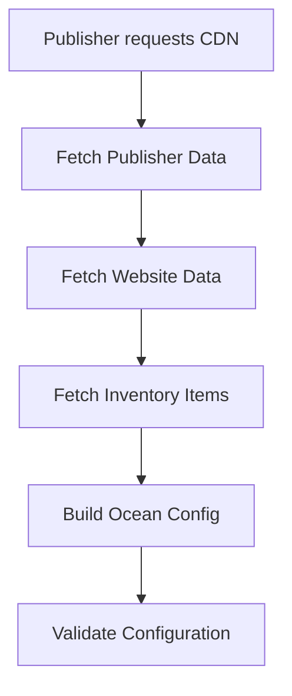
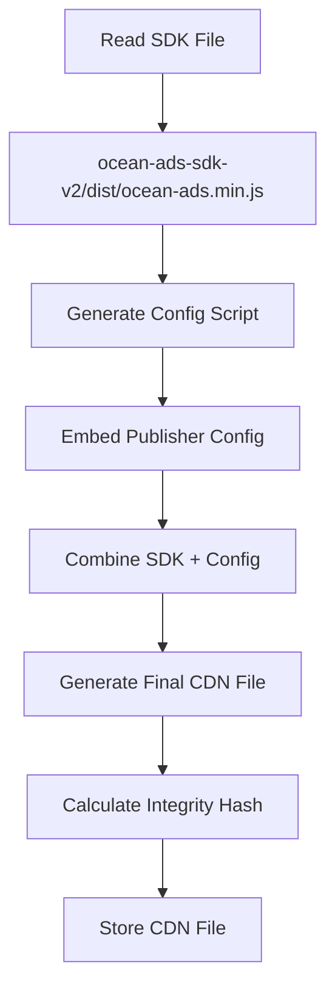
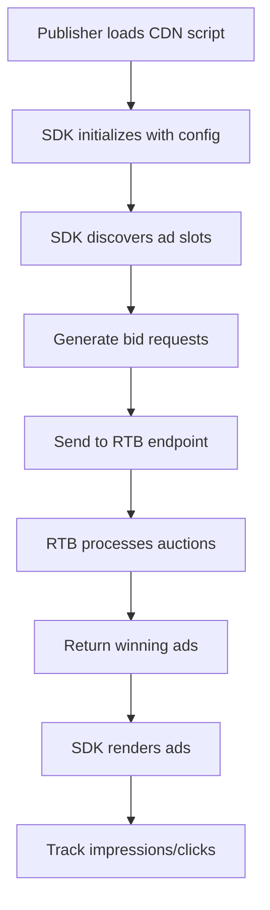

# Ocean Ads CDN Workflow - Complete Documentation

## 🎯 Overview

The Ocean Ads CDN system generates publisher-specific JavaScript files that embed your SDK with custom configurations. This allows publishers to integrate ads with a single script tag while maintaining personalized settings and inventory.

## 📋 API Response Analysis

Your successful API response shows:

```json
{
  "success": true,
  "data": {
    "cdnUrl": "http://localhost:3001/p/869e6cdc-d689-401a-91b3-faa512e4fd8c/init.js",
    "integrity": "sha384-CH9sPmu2gn/M+UAXabHOnjlEW0XVZq/O//0V0ISnizpcuHCL5b1fmxyu+HlY9B8m",
    "version": "1.6.18",
    "publisherId": "869e6cdc-d689-401a-91b3-faa512e4fd8c",
    "websiteId": "007116e2-c580-4739-90f8-1c62cbe493c4",
    "buildId": "869e6cdc-1750230074847-rcadzz",
    "environment": "production",
    "createdAt": "2025-06-18T08:14:25.895Z"
  }
}
```

## 🔄 Complete CDN Generation Workflow

### Phase 1: Configuration Building



**What Happens:**

1. **Publisher Lookup**: System fetches publisher details from database
2. **Website Lookup**: Gets website-specific settings and domain
3. **Inventory Discovery**: Retrieves all ad slot templates for the website
4. **Configuration Assembly**: Creates `IOceanConfig` object containing:
   - Publisher settings (ID, domain, preferences)
   - Website configuration (domain, categories)
   - Inventory mapping (ad slots, sizes, targeting)
   - Environment settings (debug, endpoints)

### Phase 2: SDK Integration & CDN Generation



**What Happens:**

1. **SDK Loading**: Reads your compiled SDK from `../ocean-ads-sdk-v2/dist/ocean-ads.min.js`
2. **Configuration Script**: Creates a JavaScript snippet that embeds publisher config
3. **File Combination**: Merges SDK + configuration into single file
4. **Security**: Generates SHA-384 integrity hash for security
5. **Storage**: Saves file to `./cdn-files/p/{publisherId}/init.js`

### Phase 3: CDN File Structure

```
cdn-files/
└── p/
    └── 869e6cdc-d689-401a-91b3-faa512e4fd8c/
        ├── init.js          # The actual CDN file
        └── metadata.json    # Build metadata & cache info
```

**Generated CDN File (`init.js`) Contains:**

```javascript
/*!
 * Ocean Ads SDK
 * Publisher: 869e6cdc-d689-401a-91b3-faa512e4fd8c
 * Generated: 2025-06-18T08:14:25.895Z
 */

// 1. Publisher Configuration
(function () {
  'use strict';
  window.__OCEAN_CONFIG__ = {
    publisher: {
      id: '869e6cdc-d689-401a-91b3-faa512e4fd8c',
      domain: 'example.com',
    },
    website: {
      id: '007116e2-c580-4739-90f8-1c62cbe493c4',
      domain: 'publisher-site.com',
    },
    inventory: [
      {
        slotId: 'header-banner',
        sizes: [
          [728, 90],
          [970, 250],
        ],
        floorPrice: 0.5,
      },
      // ... more inventory items
    ],
    settings: {
      debug: false,
      endpoints: {
        bid: 'http://localhost:3001/bid',
        track: 'http://localhost:3001/track',
      },
    },
  };
})();

// 2. Your Complete SDK Code
// [Contents of ocean-ads-sdk-v2/dist/ocean-ads.min.js]
(function () {
  // Your entire SDK implementation
  // ConfigManager, SlotManager, RenderEngine, etc.
})();
```

## 🌐 Publisher Integration Workflow

### How Publishers Use the CDN Link

**1. Simple HTML Integration:**

```html
<!DOCTYPE html>
<html>
  <head>
    <title>Publisher Website</title>
    <!-- Load Ocean Ads SDK with publisher-specific config -->
    <script
      src="http://localhost:3001/p/869e6cdc-d689-401a-91b3-faa512e4fd8c/init.js"
      integrity="sha384-CH9sPmu2gn/M+UAXabHOnjlEW0XVZq/O//0V0ISnizpcuHCL5b1fmxyu+HlY9B8m"
      crossorigin="anonymous"
    ></script>
  </head>
  <body>
    <!-- Ad slot containers -->
    <div id="header-banner" data-ocean-slot="header-banner"></div>
    <div id="sidebar-ad" data-ocean-slot="sidebar-300x250"></div>

    <script>
      // SDK is already loaded with publisher config
      // Your SDK auto-initializes and starts requesting ads
      OceanAds.init(); // This uses the embedded config
    </script>
  </body>
</html>
```

**2. What Happens When Script Loads:**

1. **Configuration Available**: `window.__OCEAN_CONFIG__` contains all publisher settings
2. **SDK Initialization**: Your SDK reads the config and initializes
3. **Slot Discovery**: SDK finds ad containers on the page
4. **RTB Requests**: SDK starts making bid requests to your RTB system

## 🎯 RTB Integration Flow

### From CDN to Ad Serving



**1. SDK Initialization:**

```javascript
// Your SDK reads the embedded config
const config = window.__OCEAN_CONFIG__;
const sdk = new OceanAds(config);

// SDK knows:
// - Which ad slots to fill
// - Publisher's floor prices
// - RTB endpoints to call
// - Tracking preferences
```

**2. Bid Request Generation:**

```javascript
// SDK creates bid requests for each slot
const bidRequest = {
  publisherId: '869e6cdc-d689-401a-91b3-faa512e4fd8c',
  websiteId: '007116e2-c580-4739-90f8-1c62cbe493c4',
  slots: [
    {
      slotId: 'header-banner',
      sizes: [
        [728, 90],
        [970, 250],
      ],
      floorPrice: 0.5,
    },
  ],
  context: {
    url: window.location.href,
    referrer: document.referrer,
    device: detectDevice(),
  },
};

// Send to your RTB system
fetch(config.settings.endpoints.bid, {
  method: 'POST',
  body: JSON.stringify(bidRequest),
});
```

## 📁 Integration with Your SDK Examples

### Using CDN in Your Example Files

**Update your `examples/basic.html`:**

```html
<!DOCTYPE html>
<html>
  <head>
    <title>Ocean Ads SDK - Basic Example</title>
    <!-- Replace local SDK with CDN version -->
    <script
      src="http://localhost:3001/p/869e6cdc-d689-401a-91b3-faa512e4fd8c/init.js"
      integrity="sha384-CH9sPmu2gn/M+UAXabHOnjlEW0XVZq/O//0V0ISnizpcuHCL5b1fmxyu+HlY9B8m"
      crossorigin="anonymous"
    ></script>
  </head>
  <body>
    <h1>Basic Ocean Ads Example</h1>

    <!-- Ad slots will use inventory from CDN config -->
    <div id="header-banner" data-ocean-slot="header-banner">Loading ad...</div>

    <script>
      // No manual configuration needed!
      // Config is already embedded from CDN
      OceanAds.init().then(() => {
        console.log('Ocean Ads initialized with CDN config');
      });
    </script>
  </body>
</html>
```

**Update your `examples/multiple-ad-slot.html`:**

```html
<!DOCTYPE html>
<html>
  <head>
    <title>Ocean Ads SDK - Multiple Slots</title>
    <script
      src="http://localhost:3001/p/869e6cdc-d689-401a-91b3-faa512e4fd8c/init.js"
      integrity="sha384-CH9sPmu2gn/M+UAXabHOnjlEW0XVZq/O//0V0ISnizpcuHCL5b1fmxyu+HlY9B8m"
      crossorigin="anonymous"
    ></script>
  </head>
  <body>
    <!-- Multiple ad slots using inventory from publisher config -->
    <div id="header-banner" data-ocean-slot="header-banner"></div>
    <div id="sidebar-ad" data-ocean-slot="sidebar-300x250"></div>
    <div id="footer-banner" data-ocean-slot="footer-728x90"></div>

    <script>
      // SDK auto-discovers all slots and starts serving ads
      OceanAds.init({
        debug: true, // Override debug mode if needed
      });
    </script>
  </body>
</html>
```

## 🔧 Testing & Development Workflow

### Local Development

```bash
# 1. Build your SDK
cd ocean-ads-sdk-v2
npm run build

# 2. Generate CDN for testing
cd ../programmatic_adtech_backend
curl -X POST http://localhost:3000/api/publishers/869e6cdc-d689-401a-91b3-faa512e4fd8c/websites/007116e2-c580-4739-90f8-1c62cbe493c4/generate-cdn \
  -H "Authorization: Bearer YOUR_TOKEN" \
  -H "Content-Type: application/json" \
  -d '{}'

# 3. Test in examples
cd ../ocean-ads-sdk-v2/examples
# Update HTML files to use CDN URL
# Open in browser and test
```

### CDN File Verification

```bash
# Check generated CDN file
cat ./cdn-files/p/869e6cdc-d689-401a-91b3-faa512e4fd8c/init.js

# Verify it contains:
# 1. Your SDK code
# 2. Publisher configuration
# 3. Proper initialization
```

## 🎯 Business Value & Use Cases

### Why This CDN Approach?

1. **Publisher Simplicity**: One script tag, no configuration needed
2. **Personalization**: Each publisher gets customized SDK with their settings
3. **Performance**: Pre-built, cached, CDN-served files
4. **Security**: Integrity hashes prevent tampering
5. **Version Management**: Controlled SDK updates per publisher
6. **Analytics**: Track which publishers use which SDK versions

### Real-World Usage

```html
<!-- Publisher just needs this one line -->
<script src="http://localhost:3001/p/{publisherId}/init.js"></script>

<!-- SDK automatically:
     - Configures for their inventory
     - Sets their floor prices  
     - Uses their RTB endpoints
     - Applies their targeting rules
     - Starts serving ads immediately
-->
```

## ⚠️ Current Status & Missing Pieces

### ✅ What's Working Now:

- CDN generation and storage
- SDK integration and embedding
- Configuration building from database
- File integrity and caching
- Publisher-specific URLs

### 🔄 Areas for Next Chat Discussion:

1. **RTB Endpoint Integration**

   - Verify RTB endpoints in generated config match your RTB module
   - Test actual bid request flow from SDK to RTB system
   - Ensure tracking URLs are correctly embedded

2. **SDK Auto-Initialization**

   - Confirm your SDK automatically reads `window.__OCEAN_CONFIG__`
   - Test that inventory slots are properly mapped
   - Verify ad slot discovery and rendering

3. **Development vs Production URLs**

   - CDN currently generates production URLs (`http://localhost:3001`)
   - Need to configure for local development testing
   - Environment-specific endpoint configuration

4. **Cache Management**

   - When to regenerate CDN files (inventory changes, SDK updates)
   - Cache invalidation strategies
   - Version management for SDK updates

5. **Example Files Integration**

   - Update your example HTML files to use real CDN URLs
   - Test complete flow from HTML → CDN → RTB → Ad Rendering
   - Performance testing and optimization

6. **Error Handling & Monitoring**
   - CDN file delivery monitoring
   - SDK initialization error handling
   - RTB request failure fallbacks

### 🎯 Next Steps Checklist:

1. **Test CDN URL in browser** - Verify file loads and contains expected content
2. **Update SDK examples** - Replace local script tags with CDN URLs
3. **Verify RTB integration** - Ensure SDK sends requests to correct endpoints
4. **Test complete ad flow** - HTML → CDN → SDK → RTB → Ad rendering
5. **Performance optimization** - CDN delivery, file size, load times

## 🚀 Success Criteria

Your CDN system will be fully functional when:

- Publishers can include one script tag and ads start serving
- SDK automatically configures using embedded publisher settings
- Bid requests flow correctly to your RTB system
- Ads render properly in publisher pages
- Performance meets industry standards (< 2s to first ad)

The foundation is solid - now it's about connecting all the pieces and optimizing the flow!
