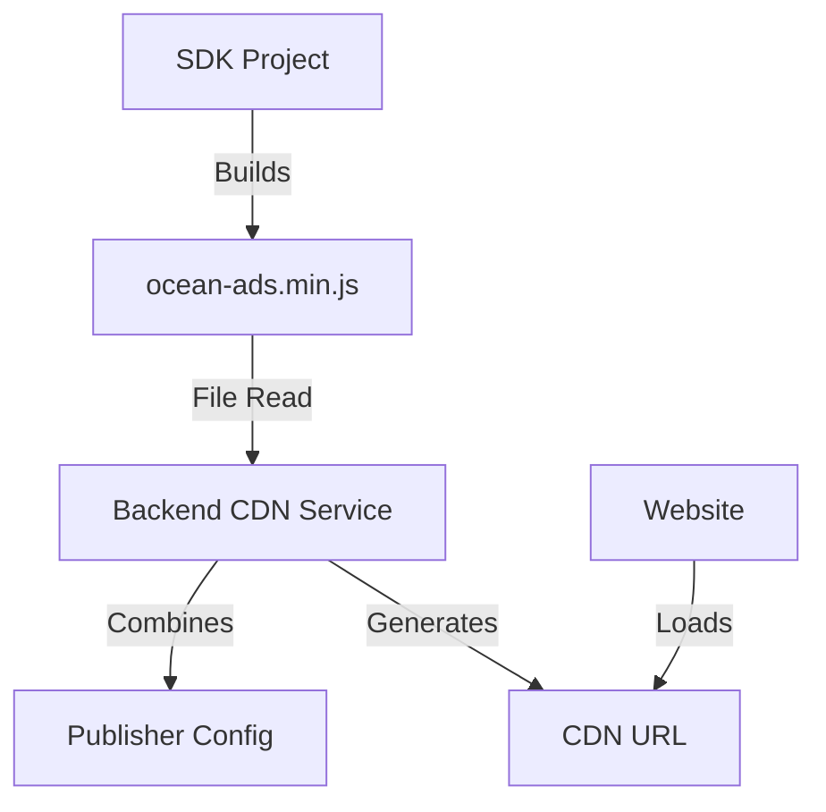

# 🔗 SDK Connection Guide

## Understanding Your Architecture (You're Doing It RIGHT! ✅)

### Current Setup Overview

```
📁 ocean-ads-sdk-v2/           # Your SDK Project
├── dist/ocean-ads.min.js      # ← Built SDK file
└── examples/                  # ← Served on port 3000

📁 programmatic_adtech_backend/ # Your Backend Project
├── src/cdn/                   # ← CDN Generator
└── cdn-files/                 # ← Generated CDN files
```

### Port 3000 is NOT a Problem! 🚀

**SDK Project (Port 3000):**

- ✅ **Purpose**: Development server for testing SDK examples
- ✅ **What it serves**: HTML examples that use the SDK
- ✅ **File output**: Builds `ocean-ads.min.js` to filesystem

**Backend Project (Different Port):**

- ✅ **Purpose**: CDN generation and API services
- ✅ **How it works**: Reads SDK file from filesystem (NOT port 3000)
- ✅ **Connection**: File-based, not HTTP-based

## 🛠️ Local Development Setup

### Step 1: Set Environment Variable

Create a `.env` file in your backend project root:

```env
# Point to your SDK project's build output
SDK_BUILD_PATH=C:\Users\Shaikh Asif\OneDrive\Desktop\PaidProjects\ocean-ads-sdk-v2\dist\ocean-ads.min.js

# Other configuration
NODE_ENV=development
```

### Step 2: Workflow

1. **Start SDK Project** (Terminal 1):

   ```bash
   cd C:\Users\Shaikh Asif\OneDrive\Desktop\PaidProjects\ocean-ads-sdk-v2
   npm run serve
   ```

   - This runs on port 3000 ✅
   - Builds SDK files automatically ✅
   - Serves examples for testing ✅

2. **Start Backend Project** (Terminal 2):
   ```bash
   cd C:\Users\Shaikh Asif\OneDrive\Desktop\PaidProjects\programmatic_adtech_backend
   npm run start:dev
   ```
   - This runs on different port (probably 3001) ✅
   - Reads SDK file from path above ✅
   - Generates CDN files ✅

### Step 3: Test the Connection

```bash
# Test CDN generation
curl -X POST "http://localhost:3001/api/publishers/869e6cdc-d689-401a-91b3-faa512e4fd8c/websites/007116e2-c580-4739-90f8-1c62cbe493c4/generate-cdn" \
-H "Authorization: Bearer YOUR_TOKEN" \
-H "Content-Type: application/json"
```

## 🎯 Connection Flow Explained



1. **SDK Project**: Builds `ocean-ads.min.js` file
2. **Backend**: Reads file from filesystem
3. **Backend**: Wraps SDK with publisher config
4. **Backend**: Serves via CDN URL
5. **Website**: Loads personalized SDK

## 🔧 Configuration Options

### Option 1: Environment Variable (Recommended)

```env
SDK_BUILD_PATH=C:\Users\Shaikh Asif\OneDrive\Desktop\PaidProjects\ocean-ads-sdk-v2\dist\ocean-ads.min.js
```

### Option 2: Relative Path

```env
SDK_BUILD_PATH=../ocean-ads-sdk-v2/dist/ocean-ads.min.js
```

### Option 3: Auto-Detection

Don't set `SDK_BUILD_PATH` - the system will auto-detect based on your Windows path.

## 🚀 Production Deployment

### For Docker/Linux Production:

1. **Copy SDK during build**:

   ```dockerfile
   # In your backend Dockerfile
   COPY ../ocean-ads-sdk-v2/dist/ocean-ads.min.js /app/sdk/
   ```

2. **Set production environment**:
   ```env
   SDK_BUILD_PATH=/app/sdk/ocean-ads.min.js
   NODE_ENV=production
   ```

### For NPM Package Distribution:

1. **Publish SDK as NPM package**:

   ```bash
   cd ocean-ads-sdk-v2
   npm publish
   ```

2. **Install in backend**:

   ```bash
   cd programmatic_adtech_backend
   npm install @ocean-ads/sdk
   ```

3. **Use NPM path**:
   ```env
   SDK_BUILD_PATH=./node_modules/@ocean-ads/sdk/dist/ocean-ads.min.js
   ```

## 🔍 Troubleshooting

### ❌ Problem: "SDK file not found"

**Solution**: Check your `SDK_BUILD_PATH` environment variable

### ❌ Problem: "Port 3000 conflict"

**Solution**: No conflict! They're separate services:

- SDK port 3000 = Examples server
- Backend different port = API server

### ❌ Problem: "CDN generation fails"

**Solution**: Make sure SDK project is built:

```bash
cd ocean-ads-sdk-v2
npm run build
```

## 📝 Quick Checklist

- [ ] SDK project builds successfully
- [ ] `ocean-ads.min.js` exists in SDK dist folder
- [ ] Backend `.env` has correct `SDK_BUILD_PATH`
- [ ] Both projects run on different ports
- [ ] CDN generation works

## 🎉 Success Indicators

When everything works correctly, you should see:

1. **SDK Project Logs**:

   ```
   ✓ Building SDK (development mode)...
   Created bundle ocean-ads.min.js: 171.04 kB → 30.21 kB (gzip)
   Available on: http://127.0.0.1:3000
   ```

2. **Backend Project Logs**:

   ```
   ✅ SDK file validated successfully
   Using SDK path from environment: C:\Users\...
   CDN build generated successfully
   ```

3. **Working CDN URL**:
   ```
   http://localhost:3001/p/869e6cdc-d689-401a-91b3-faa512e4fd8c/init.js
   ```

Your setup is **PERFECT** - keep both projects separate! 🎯
